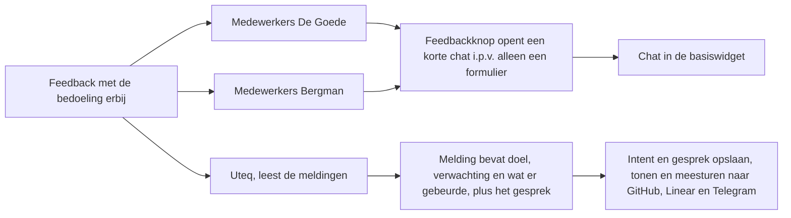

# Feedbackchat naar het basispakket · impactmap en bouwplan

**Status:** in uitvoering
**Doel:** De Goede, Bergman en Sijperda krijgen dezelfde feedbackchat als os.uteq.nl, zonder het hele MortelOS-framework in hun app.
**Orchestrator:** Opus 5.5 xhigh, de main sessie. Bouwt zelf niets: geeft de taken uit, beantwoordt de vragen van de bouwers, leest elke diff en draait zelf de tests.
**Bouwers:** Claude en Codex
**Werkmap:** /Users/uteq/Sites/uteq/laravel-feedback-hub-chat, branch `feat/intake-chat` (taken 1-2). Taak 3 in een worktree van /Users/uteq/Sites/mortelos/feedback, taak 4 in een worktree van /Users/uteq/Sites/uteq/os, taak 5 op nieuwe branches `chore/feedback-hub-0.4` vanaf main (/Users/uteq/Sites/uteq/degoede, /Users/uteq/Sites/uteq/bergman) en develop (/Users/uteq/Sites/uteq/sijperda-os).
**Oplevering:**
- uteq/laravel-feedback-hub: PR naar main, tag v0.4.0.
- mortelos/feedback: PR naar main, tag 0.6.0.
- uteq/os: PR, mergen en live zodra CI groen is (vaste afspraak).
- De Goede, Bergman en Sijperda: elk een nieuwe PR naar ^0.4. Mergen en live pas na ja van Nathan. (#62, #23 en #354 voor 0.3.2 zijn op 23-10 door een andere sessie gemerged.)

## Impactmap · beide

Gebruikers van twee klantsites merken het verschil (functioneel), en het raakt drie pakketten en drie apps met hun database (technisch).

### Functioneel

### Hergebruik

| Onderdeel | Wat er al is | Trede | Waarom niet lager |
|---|---|---|---|
| Chat-backend: agent, chat- en CSRF-controller, beschikbaarheidscheck, `ai`-config | Bestaat in /Users/uteq/Sites/mortelos/feedback/src (Ai, Http/Controllers, Support) | 5, verhuizen naar de basis | Trede 1 zou zijn: de klanten laten overstappen op mortelos/feedback. Dat trekt mortelos/framework mee (PHP ^8.4, stancl/tenancy, spatie event-sourcing, dompdf, amphp, laravel/mcp), plus mortelos/ui en de eigen pakketserver. Bergman draait nog op PHP ^8.3. Algemeen vermogen dat in de basis ontbreekt. |
| Kolommen `intent` en `transcript` + opslaan | Migratie en controller-override in mortelos/feedback; het basismodel cast beide kolommen al | 5, verhuizen | zelfde |
| Chat in de widget | Alpine-chat in de mortel-widget, gebouwd op `x-mortel::`-componenten | 5, de logica één keer in de basis, de opmaak in gewone CSS zoals de basiswidget; de mortel-widget hergebruikt de logica | De klanten hebben geen mortel-UI-componenten |
| Intent in issue, Telegram-regel en adminpagina | Subklasse van IssueBodyBuilder en een view-slot in mortelos/feedback | 5, verhuizen | zelfde |

Tegenlezer: Sonnet 5.5 high. Hij vond geen lagere trede. Wel vier verwerkte punten:
- `laravel/ai` gaat in `suggest` in plaats van `require`. De chat staat alleen aan als het pakket er is, zodat andere gebruikers van de basis (zoals Sijperda) niets extra meekrijgen. De Goede en Bergman installeren het zelf.
- Intent en transcript horen direct in de basiscontroller.
- Issue-tekst, Telegram-regel en adminpagina tonen de intent direct in de basis. De mortel-subklasse, de view-slot en `admin/intent.blade.php` vervallen dan.
- De migratie houdt exact dezelfde bestandsnaam. uteq/os heeft hem al in `database/migrations` en in `database/migrations/tenant`.

### Technisch

| Wijziging | Onderdeel | Risico | Zo testen we het |
|---|---|---|---|
| Chatroutes en CSRF-route in de basis | /Users/uteq/Sites/uteq/laravel-feedback-hub-chat/routes/web.php | Dubbele routenamen als mortelos/feedback ze ook nog registreert | mortelos/feedback 0.6 vereist basis ^0.4 en verwijdert zijn eigen routes in dezelfde release; route-test in beide pakketten |
| Migratie `intent`/`transcript` in de basis | database/migrations/2026_09_15_000000_add_intent_to_feedback_hub_reports_table.php | uteq/os heeft dezelfde migratie al gedraaid (gepubliceerde kopie) | Zelfde bestandsnaam, dus Laravel ziet hem als al gedraaid; plus een `hasColumn`-guard. uteq/os-CI draait de tenant-migraties |
| `laravel/ai` als `suggest` in de basis, `require` in de apps die de chat willen | composer.json van de basis, De Goede en Bergman | Chat-route faalt zonder laravel/ai; versieconflict | `FeedbackAiAvailability` geeft false zonder laravel/ai (test); alle drie de apps komen uit op v0.4.5 |
| Basiswidget krijgt chat-, samenvattings- en formuliermodus | resources/views/components/floating-button.blade.php | Formulier stuk als de chat uit staat | Componenttest met chat aan en uit; browsercheck op een lokale De Goede |
| mortel-widget hergebruikt de logica uit de basis | /Users/uteq/Sites/mortelos/feedback/resources/views/components/floating-button.blade.php | Chat op os.uteq.nl stuk | Browsertests van mortelos/feedback (tests/Browser) en een rooktest op os.uteq.nl na de uitrol |
| Klanten naar ^0.4 | composer.json/lock, vet.json, gepubliceerde inspector-js | Migratie draait niet bij deploy | Feature-tests van de klant; deploy-log controleren bij uitrol |

## Buiten scope

- De chat bij De Goede en Bergman aanzetten. Dat is een env-wijziging op een klantserver en kost API-tegoed, dus dat doen we pas na het ja van Nathan.
- De Telegram-bezorging per kanaal uit mortelos/feedback naar de basis halen.
- Bergman naar PHP 8.4.
- Andere klantsites. Na dit plan volgt een lijst van live sites met ingelogde gebruikers, en per site een ja van Nathan (keuze 2A, 23-10).

## Taken

| # | Taak | Bouwer | Na | Klaar als |
|---|---|---|---|---|
| 1 | Chat-backend naar de basis | gpt-6.1-sol, medium | - | `vendor/bin/pest --parallel --processes=4` groen in de basis |
| 2 | Chat in de basiswidget, logica herbruikbaar | Opus 5.5, high | 1 | idem, plus componenttests chat aan/uit |
| 3 | mortelos/feedback gebruikt de chat uit de basis | Sonnet 5.5, high | 2 + tag v0.4.0 | suite + phpstan + browsertests van mortelos/feedback groen |
| 4 | uteq/os naar feedback 0.6 / basis 0.4 | gpt-6.1-sol, medium | 3 + tag 0.6.0 | suite met 4 processen groen, vet schoon |
| 5a | De Goede naar ^0.4 | Sonnet 5.5, high | tag v0.4.0 | feedback-tests en volle suite groen |
| 5b | Bergman naar ^0.4 | gpt-6.1-sol, medium | tag v0.4.0 | idem |
| 5c | Sijperda naar ^0.4 (develop) | Sonnet 5.5, high | tag v0.4.0 | idem |

### 1 · Chat-backend naar de basis

**Bestanden (nieuw of gewijzigd, alles onder /Users/uteq/Sites/uteq/laravel-feedback-hub-chat):**
- `composer.json`: `laravel/ai: ^0.4` in `suggest` en `require-dev`, niet in `require`
- `config/feedback-hub.php`: blok `ai` (enabled, provider, model, max_turns), zelfde env-namen en standaarden als mortelos/feedback
- `src/Ai/FeedbackIntakeAgent.php`
- `src/Http/Controllers/FeedbackChatController.php`
- `src/Http/Controllers/FeedbackCsrfTokenController.php`
- `src/Support/FeedbackAiAvailability.php`
- `routes/web.php`: `feedback-hub.chat` (POST /chat) en `feedback-hub.csrf` (GET /session/csrf)
- `database/migrations/2026_09_15_000000_add_intent_to_feedback_hub_reports_table.php`
- `src/FeedbackHubServiceProvider.php`: de nieuwe migratie publiceren
- `src/Http/Controllers/StoreFeedbackReportController.php`: intent en transcript valideren en opslaan
- `src/Support/IssueBodyBuilder.php`: intent in issue en Telegram-bericht
- `resources/views/admin/show.blade.php`: intent en gesprek tonen
- `README.md`: chat-sectie
- tests in `tests/Feature` en `tests/Unit`

**Opdracht:** De code komt uit /Users/uteq/Sites/mortelos/feedback, zie de bestanden in de opdracht. Gedrag blijft gelijk, en de namespace wordt `Uteq\FeedbackHub`. Neem de tests mee. `FeedbackAiAvailability` geeft false als laravel/ai niet geïnstalleerd is. De intent komt direct in de issue-tekst, de Telegram-regel en de adminpagina van de basis. De lege hooks blijven bestaan voor andere uitbreidingen.

**Niet:** de widget (taak 2), mortelos/feedback, taggen.

### 2 · Chat in de basiswidget

**Bestanden:** /Users/uteq/Sites/uteq/laravel-feedback-hub-chat/resources/views/components/floating-button.blade.php, een nieuw partial voor de gedeelde Alpine-logica, en /Users/uteq/Sites/uteq/laravel-feedback-hub-chat/tests/Feature/FloatingButtonComponentTest.php.

**Opdracht:**
- Breng chat, samenvatting en de nette afhandeling na een deploy (419 opnieuw proberen, uitgelogd melden) over naar de basiswidget, in de stijl van de basis.
- De Alpine-logica komt in een partial die de mortel-widget straks kan hergebruiken. Openen, sluiten en melding tonen moeten daarbij te vervangen zijn.

**Niet:** mortelos/feedback, backend.

### 3 · mortelos/feedback gebruikt de basis

**Opdracht:**
- Verwijder uit mortelos/feedback wat nu in de basis staat: agent, chat- en CSRF-controller, beschikbaarheidscheck, routes/chat.php, het `ai`-config-blok, de intent-migratie, de intent-velden in StoreFeedbackReportController, IssueBodyBuilder voor de intent en de view-slot.
- Laat de mortel-widget de gedeelde logica uit de basis gebruiken en houd alleen de mortel-opmaak.
- Zet de vereiste naar `uteq/laravel-feedback-hub: ^0.4`.

**Niet:** kanaalbezorging, uteq/os.

### 4 · uteq/os

**Opdracht:**
- Bump `mortelos/feedback` naar ^0.6 en de basis naar ^0.4.
- Werk vet.json bij met `bin/vet-agent`.
- Draai de volle suite met 4 processen en maak een PR.

**Niet:** mergen; dat doet de orchestrator na groene CI.

### 5a/5b/5c · De Goede, Bergman en Sijperda

**Opdracht:**
- Maak een nieuwe branch `chore/feedback-hub-0.4` vanaf main (Sijperda: develop). Zet de vereiste naar `^0.4` en voeg `laravel/ai:^0.4` toe.
- Neem de nieuwe migratie mee.
- Publiceer de inspector-js opnieuw en werk vet.json bij.
- Draai de tests en werk de PR-tekst bij.

**Niet:** mergen, Forge, env.

## Eindcontrole (draait de orchestrator zelf)

- Basis: `vendor/bin/pest --parallel --processes=4`
- mortelos/feedback: suite, phpstan en browsertests
- uteq/os: CI groen, live, en rooktest van de chat op https://os.uteq.nl
- Lokale De Goede op basis v0.4.0, met de chat aan en een echte sleutel inline. Een browsercheck met schermafbeeldingen doorloopt chat → samenvatting → versturen en toont daarna de melding in /feedback-hub met intent en gesprek.
- De Goede, Bergman en Sijperda: CI van de PR groen

## Voortgang

- 2026-10-23 · worktree /Users/uteq/Sites/uteq/laravel-feedback-hub-chat aangemaakt vanaf origin/main (c7fe7c8)
- 2026-10-23 12:05 · akkoord Nathan op plan, plus Sijperda erbij (1A) en andere klanten later per site (2A)
