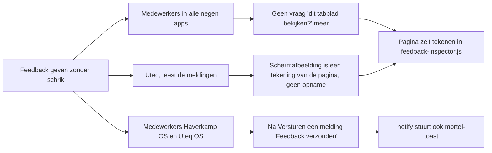

# Schermafbeelding zonder browservraag en melding na Versturen · impactmap en bouwplan

**Status:** gebouwd; PR open, mergen en tag `v0.5.0` wachten op ja van Nathan
**Doel:** Wie in een klantapp op de feedbackknop klikt, krijgt geen vraag van de browser meer, en ziet in elke app na Versturen een melding.
**Soort werk:** pakket dat bij negen apps draait (geen `mortelos/*`, wel gedeeld), dus wint: een herbruikbaar patroon dat de apps via een bestaande haak overnemen, zonder klantnamen of klantregels in de code.
**Orchestrator:** Opus 5.5 xhigh, de main sessie. Bouwt zelf niets: geeft de taken uit, beantwoordt de vragen van de bouwers, leest elke diff en draait zelf de tests.
**Bouwers:** Claude en Codex
**Werkmap:** /Users/uteq/Sites/uteq/laravel-feedback-hub-capture, branch `feat/silent-screenshot-and-toast` (vanaf origin/main = v0.4.3)
**Oplevering:** één PR naar main van uteq/laravel-feedback-hub. Mergen en tag `v0.5.0` pas na ja van Nathan. Geen bump in een app zonder ja.

## Impactmap · beide

Gebruikers van negen apps merken het verschil (functioneel), en het raakt een pakket met een gepubliceerd script dat in elke app als kopie staat (technisch).

### Functioneel

### Wie gebruikt het nu (31-10, uit composer.lock op de standaardbranch)

| App | Repo | Versie | UI-kit | Melding na Versturen nu | Na v0.5.0 |
|---|---|---|---|---|---|
| Sijperda OS | uteq/sijperda-os (develop) | v0.4.3 | mortelos/ui 0.6.3 | ja, eigen brug (PR #448) | dubbel, tenzij de brug `.prevent` krijgt of weg gaat (vervolg S1) |
| Haverkamp OS | uteq/bbh | v0.4.3 | mortelos/ui 0.6.0, `<x-mortel::toast />` staat er | **nee** | ja |
| Uteq OS | uteq/os | v0.4.0, via mortelos/feedback 0.7.1 | mortelos/ui 0.6.7 | **nee**: mortelos/feedback stuurt al `mortel-toast`, maar OS heeft nergens `<x-mortel::toast />` | pas na vervolg O1 |
| VRLK | uteq/vrlk-mvp | v0.4.3 | Flux 2.12 | **nee**: de layout met de knop (`resources/views/components/layouts/app.blade.php`) heeft geen `<flux:toast />` | pas na vervolg V1 |
| Bergman | uteq/bergman | v0.4.3 | Flux 2.13 | ja | ja |
| De Goede | uteq/degoede | v0.4.3 | Flux 2.14 | ja | ja |
| Biobase | uteq/biobase-v2 | v0.4.3 | Flux 2.13 | ja | ja |
| CivilGrow | uteq/civilgrow (dev, nog niet op main) | v0.4.3 | Flux 2.13 | ja | ja |
| Easie Sync | uteq/easie-sync (dev, nog niet op main) | v0.4.3 | Flux 2.13 | ja | ja |

Alle apps behalve Uteq OS hebben een **gepubliceerde kopie** van het script in `resources/js/vendor/feedback-hub/feedback-inspector.js` (gelijk aan v0.4.3). Een bump alleen verandert de schermafbeelding daar dus niet. Uteq OS importeert het script rechtstreeks uit `vendor/`. Alle apps vragen `^0.4`, dus een tag `v0.5.0` komt nergens vanzelf binnen.

### Hergebruik

| Onderdeel | Wat er al is | Trede | Waarom niet lager |
|---|---|---|---|
| Melding in MortelOS-apps | `mortelos/ui` toast: window-event `mortel-toast` `{ text, heading?, variant? }` (/tmp/mortel-ui/docs/components/overlay.md, v0.6.9). mortelos/feedback 0.7.1 overschrijft `notify()` al zo (`resources/views/components/floating-button.blade.php:23-24`). Sijperda: brug op `feedback-hub:toast`, reuse: blocks | 4 | De haak `notify()` bestaat; alleen de standaard krijgt één event erbij. Lager kan niet: de apps zonder brug tonen nu niets |
| Dubbele melding voorkomen | Niets | 4 | `feedback-hub:toast` wordt `cancelable`. Een app die hem zelf afhandelt roept `preventDefault()` (Alpine: `.prevent`) en het pakket stuurt dan geen `mortel-toast`. Eén regel; zonder dit toont Sijperda twee meldingen |
| Schermafbeelding zonder vraag | `getDisplayMedia` (vraagt altijd toestemming). Geen browser-API maakt zonder vraag een opname van het tabblad. In geen enkele klantcatalogus (building_blocks.sources, 11 catalogi) en niet in de MortelOS-catalogus staat iets dat de pagina tekent | 5 | Algemeen vermogen dat ontbreekt. Keuze tussen eigen code en een bibliotheek: zie "Bibliotheek" hieronder |
| Browsertests in een pakket | mortelos/feedback: `pestphp/pest-plugin-browser` + `package.json` met `playwright` in require-dev, suite `Browser` in phpunit.xml | 1 (patroon) | - |
| Script uit `vendor/` laden i.p.v. kopie | Uteq OS doet dat al: `import '../../vendor/uteq/laravel-feedback-hub/resources/js/feedback-inspector.js'` | 1 (patroon) | - |

**Bron hergebruik:** building_blocks.sources (MCP "UTEQ Mortel"), 11 catalogi opgehaald; plus `gh` op alle 101 actieve uteq-repo's (composer.lock).

**Eenvoudigste route:** alleen `getDisplayMedia` eruit en altijd de bestaande placeholder sturen; `notify()` stuurt ook `mortel-toast`.
**Gekozen route:** pagina zelf tekenen, placeholder alleen als tekenen faalt; `notify()` stuurt `feedback-hub:toast` (annuleerbaar) en daarna `mortel-toast`. Zonder echte schermafbeelding verliest Uteq het belangrijkste deel van elke melding, en de AI-intake kijkt er ook naar.

### Bibliotheek (vraagt ja van Nathan)

Proef op 31-10 door gpt-6.1-sol high, rapport en beelden in /tmp/fh-spike (RAPPORT.md, out/*-montage.png). Lokaal Sijperda (binnenste scrollvlak, zijbalk) en De Goede (sticky kop, open menu), na scrollen, met markering, wachtwoord- en tokenveld en twee iframes, in Chromium, WebKit en Firefox. De orchestrator heeft de beelden zelf bekeken.

| Kandidaat | Grootte (gzip) | Tijd | Beeld (1-5) | Waarom wel of niet |
|---|---|---|---|---|
| Eigen code (89 regels) | 2 KB | 61-638 ms | 2-3 | Na scrollen verschuift de inhoud (Sijperda: titel weg achter de zijbalk; De Goede 64 px te hoog, dus de markering staat om het verkeerde onderdeel). Open menu ontbreekt. Goed maken kost volgens de proef ruim meer dan 150 extra regels die we zelf moeten onderhouden |
| modern-screenshot 4.7.0 | 11 KB | 1,6-4,5 s | 2-3 | Pictogrammen worden tekst ("expand_more") in De Goede, ingevulde velden springen terug, te traag |
| html-to-image 1.11.13 | 7 KB | - | 1 | Gaf op beide sites geen afbeelding |
| **@zumer/snapdom 3.7.0** (MIT, bijgewerkt 29-10-2026, geen eigen dependencies) | 100 KB | 240-952 ms | 4 | Scrollpositie, zijbalk, kop, open menu, markering en ingevulde velden kloppen. Gevoelige velden leeg maken werkt via een haak (getest). Iframes van een ander domein blijven leeg; in Firefox viel een deel van het testblok weg |

Voorstel: **@zumer/snapdom 3.7.0**, als één vast bestand in het pakket (`resources/js/snapdom.mjs`, ongewijzigd, licentiekop en LICENSE erbij, controle tegen de npm-checksum `sha512-YUbc4psi…`). Het wordt pas bij de klik geladen (`import('./snapdom.mjs')`), dus de 100 KB komt niet bij het laden van een pagina. Optie `useProxy` blijft leeg: geen verzoeken via een derde partij. Wat er al is volstaat niet: `getDisplayMedia` vraagt altijd toestemming, en geen andere browser-API maakt zonder vraag een afbeelding van het tabblad.

Waarom een vast bestand en niet `npm install` in elke app: dan hoeft geen enkele app zijn `package.json` aan te passen, staat de versie op één plek vast, en breekt de build van een app niet als hij de npm-stap vergeet. Nadeel: updates doen we met de hand.

Alleen voor de tests van het pakket, nooit naar een app: `pestphp/pest-plugin-browser` ^4.3 en `livewire/livewire` ^4 (levert Alpine) in require-dev, en `playwright` 1.61.1 in een nieuwe `package.json`. Dat is hetzelfde patroon als mortelos/feedback.

`getDisplayMedia` gaat er helemaal uit. Als tekenen faalt, stuurt het pakket de bestaande placeholder ("Screenshot niet beschikbaar"). Een vraag als terugval zou het probleem in zeldzame gevallen terugbrengen, en dan juist op een pagina die al raar doet.

Tegenlezer: Sonnet 5.5 high. Treden 1 en 5 klopten volgens hem; hij vond in geen enkele app een bibliotheek die de pagina tekent. Verwerkt:
- Twee taken worden één: taak 2 kon pas na taak 1, dus een tweede bouwer kost alleen een extra overdracht.
- Het verbergen en terugzetten van widget en instructiebalk gaat eruit. De balk is al weg na `deactivate()`, de widget gaat via snapdom's `exclude`.
- `dpr: 1` staat nu expliciet in de opdracht. `toPng` geeft een `` terug, dus de bouwer gebruikt `.src`. Er komt een grens van 10 s, daarna de placeholder.
- De Install-sectie van de README herschrijven we niet; er komt alleen een upgrade-notitie.
- De README zegt dat alleen invoervelden leeg getekend worden.
- Het oude eigen script in CivilGrow en Easie Sync komt in de PR-tekst.

Niet overgenomen, met reden:
- Het voorstel om de annuleerbare `feedback-hub:toast` te schrappen en de Sijperda-brug weg te halen. Dat kost twee regels en één test minder. Maar Sijperda verliest dan zijn eigen tekst "Verstuurd · Bedankt voor je tip.", en welke tekst een klant ziet is niet aan mij. Met `.prevent` blijft die tekst.
- Gevoelige velden via `exclude` weglaten in plaats van via de plugin leegmaken. De plugin is in de proef bewezen en laat een leeg veld zien in plaats van een gat.

Kanttekening: de proef bewees het leegmaken in Chromium en WebKit. In Firefox viel het testblok al zonder leegmaken weg, dus daar is het niet bewezen.

### Technisch

| Wijziging | Onderdeel | Beveiliging | Snelheid | Risico | Zo testen we het |
|---|---|---|---|---|---|
| Schermafbeelding door de pagina te tekenen; `getDisplayMedia` weg; placeholder als tekenen faalt | /Users/uteq/Sites/uteq/laravel-feedback-hub-capture/resources/js/feedback-inspector.js | Alleen in de browser van de ingelogde gebruiker, na zijn klik. Wachtwoordvelden en velden met password, token, secret, csrf, authorization of cookie in de naam worden leeg getekend (strenger dan nu: een opname toonde een zichtbaar token gewoon). Geen verzoeken naar andere hosts dan die de pagina zelf al gebruikt. Bestaande filters op URL, console, netwerk en formulier blijven ongewijzigd | Alleen bij een klik, niet per request. Tekencode wordt pas bij de klik geladen (los stuk via `import()`), dus geen extra gewicht bij elke pagina. Doel: onder 2 s op een gewone pagina | Iframes en plaatjes van een ander domein zonder CORS ontbreken (proef: avatar van ui-avatars.com, iframe example.com); in Firefox kan een blok wegvallen | Browsertest: `getDisplayMedia` wordt nooit aangeroepen, `feedback-hub-captured` krijgt een `data:image/png` ter grootte van het scherm, gevoelige velden zijn leeg in de kloon. Plus een handmatige proef op lokaal Sijperda en De Goede met schermafbeeldingen in de PR |
| snapdom meeleveren en laten publiceren | /Users/uteq/Sites/uteq/laravel-feedback-hub-capture/resources/js/snapdom.mjs (+ LICENSE), /Users/uteq/Sites/uteq/laravel-feedback-hub-capture/src/FeedbackHubServiceProvider.php (tag `feedback-hub-assets`) | Bestand byte voor byte gelijk aan npm 3.7.0 (checksum), MIT-licentie erbij, `useProxy` nooit gezet | Los stuk, pas bij de klik geladen | Een app die alleen het oude bestand publiceerde mist het nieuwe: de import faalt en de placeholder komt | README: script uit `vendor/` importeren (zoals Uteq OS), anders beide bestanden publiceren met `--force`; test dat de publish-tag beide bestanden bevat |
| `notify()`: Flux als die er is, anders `feedback-hub:toast` (annuleerbaar) en, als niemand hem afhandelde, `mortel-toast` met `text` = tekst of anders de kop | /Users/uteq/Sites/uteq/laravel-feedback-hub-capture/resources/views/partials/widget-script.blade.php | Tekst wordt door beide kits als tekst getoond, niet als HTML | n.v.t. | Dubbele melding in een app die beide kits heeft of een brug zonder `.prevent` | Browsertest: met `window.Flux` alleen Flux; zonder Flux één `mortel-toast` met kop, tekst en variant; met een luisteraar die `preventDefault()` roept geen `mortel-toast` |
| README | /Users/uteq/Sites/uteq/laravel-feedback-hub-capture/README.md | - | - | - | Lezen |

## Buiten scope

- Taal van de melding ("Feedback verzonden", "Referentie: FH-2026-00012") blijft zoals hij is.
- De overschrijving van `notify()` in mortelos/feedback blijft staan; ze doet hetzelfde en schaadt niet.
- Iframe-inhoud tekenen.
- De oude eigen feedbackscripts in CivilGrow en Easie Sync (`resources/js/feedback-inspector.js`, `window.FeedbackInspector`, ook met `getDisplayMedia`, nog geïmporteerd in `app.js`). Hoort bij het vervolg per app.

## Taken

| # | Taak | Bouwer | Na | Klaar als |
|---|---|---|---|---|
| 1 | Melding na Versturen + schermafbeelding zonder vraag, met browsertests | gpt-6.1-sol, high | - | `vendor/bin/pest` groen (Feature, Unit, Browser), `vendor/bin/pint --test` groen, proefafbeeldingen van lokaal Sijperda en De Goede in /tmp/fh-task1/ |

Eén bouwer: de schermafbeelding bouwt op de testopzet van de melding, er valt niets tegelijk te doen. Review door Sonnet 5.5 high.

### 1 · Melding na Versturen + schermafbeelding zonder vraag

**Bestanden:**
- /Users/uteq/Sites/uteq/laravel-feedback-hub-capture/composer.json, /Users/uteq/Sites/uteq/laravel-feedback-hub-capture/package.json (nieuw), /Users/uteq/Sites/uteq/laravel-feedback-hub-capture/.gitignore, /Users/uteq/Sites/uteq/laravel-feedback-hub-capture/phpunit.xml, /Users/uteq/Sites/uteq/laravel-feedback-hub-capture/tests/Pest.php, /Users/uteq/Sites/uteq/laravel-feedback-hub-capture/tests/Support/BrowserTestLayout.php (nieuw), /Users/uteq/Sites/uteq/laravel-feedback-hub-capture/tests/Browser/ (nieuw), /Users/uteq/Sites/uteq/laravel-feedback-hub-capture/tests/Feature/ (publish-test)
- /Users/uteq/Sites/uteq/laravel-feedback-hub-capture/resources/views/partials/widget-script.blade.php
- /Users/uteq/Sites/uteq/laravel-feedback-hub-capture/resources/js/feedback-inspector.js, /Users/uteq/Sites/uteq/laravel-feedback-hub-capture/resources/js/snapdom.mjs (nieuw), /Users/uteq/Sites/uteq/laravel-feedback-hub-capture/resources/js/snapdom.LICENSE (nieuw)
- /Users/uteq/Sites/uteq/laravel-feedback-hub-capture/src/FeedbackHubServiceProvider.php
- /Users/uteq/Sites/uteq/laravel-feedback-hub-capture/README.md

**Opdracht:**
- *Testopzet* zoals mortelos/feedback 0.7.1 (/tmp/mo-feedback): `pestphp/pest-plugin-browser` ^4.3 en `livewire/livewire` ^4 in require-dev, `package.json` met alleen `playwright` 1.61.1 als devDependency, `node_modules` in .gitignore, suite `Browser` in phpunit.xml. `BrowserTestLayout` overnemen uit /tmp/mo-feedback/tests/Support, met `@livewireScripts` (voor Alpine) in plaats van de mortel-directives.
- *Melding:* `notify(heading, text, variant)` in widget-script. Is `window.Flux?.toast` er, dan alleen Flux (zoals nu). Anders `detail = { heading, text: text || heading, variant }`, stuur `feedback-hub:toast` met `cancelable: true`, en als `dispatchEvent` `true` teruggeeft (niemand riep `preventDefault()`) ook `mortel-toast` met hetzelfde detail. Docblock bovenin bijwerken.
- *snapdom:* controleer eerst dat /tmp/libsize/_zumer_snapdom/package/dist/snapdom.mjs gelijk is aan npm 3.7.0 (`npm pack @zumer/snapdom@3.7.0` in een lege map buiten de repo, vergelijk met `npm view @zumer/snapdom@3.7.0 dist.integrity`), en kopieer `dist/snapdom.mjs` en `LICENSE` ongewijzigd.
- *captureScreenshot():* `getDisplayMedia`, video, stream en de wachttijd van 500 ms gaan eruit, net als het verbergen en terugzetten van widget en instructiebalk. In de plaats:
  `const { snapdom } = await import('./snapdom.mjs'); const image = await snapdom.toPng(document.documentElement, { clip: 'viewport', scale: 1, dpr: 1, exclude: ['[data-feedback-hub-widget]', '#feedback-hub-instruction-banner', '#feedback-hub-interaction-blocker'], plugins: [redaction] }); return image.src;`
  (`toPng` geeft een `HTMLImageElement`; `dpr: 1` expliciet, anders neemt snapdom `devicePixelRatio`). Werkt `exclude` niet voor de widget, verberg hem dan zoals nu.
  De markering (`highlightElement` vóór, `hideOverlay` in `finally`) blijft.
  `redaction` is een plugin met `afterClone({ clone })` die in de kloon `value` en het `value`-attribuut leegmaakt van `input[type=password]` en van inputs en textareas waarvan `name` of `id` password, passwd, token, secret, csrf, authorization, cookie, api_key of apikey bevat (zelfde lijst als `isSensitiveKey` in widget-script). De echte pagina blijft ongemoeid. Een plugin en geen `exclude`: het veld blijft dan zichtbaar als leeg veld, en dit is de manier die in de proef bewezen is.
  Laden en tekenen samen hooguit 10 s (`Promise.race`); faalt of duurt het langer: `console.warn` en `createPlaceholderScreenshot()`. Geen `null` meer, dat was alleen voor Annuleren in de browservraag. Geen `useProxy`.
- *Publiceren:* tag `feedback-hub-assets` publiceert ook `snapdom.mjs` naar `resources/js/vendor/feedback-hub/snapdom.mjs`.
- *Browsertests* (één of twee bestanden):
  (a) met een nep-`window.Flux.toast` gaat de melding alleen naar Flux, geen window-events;
  (b) zonder Flux, na echt Versturen (Queue::fake): precies één `feedback-hub:toast` en één `mortel-toast` met kop "Feedback verzonden", tekst "Referentie: FH-…" en variant `success`; foutpad: variant `danger` en een niet-lege tekst;
  (c) een luisteraar op `feedback-hub:toast` die `preventDefault()` roept: geen `mortel-toast`;
  (d) het echte `feedback-inspector.js` en `snapdom.mjs` op een testpagina (via een testroute), `navigator.mediaDevices.getDisplayMedia` vervangen door een teller: na activeren en een klik op een element komt `feedback-hub-captured` met een `data:image/png` van viewportbreedte, en de teller blijft 0;
  (e) een wachtwoord- en tokenveld met een waarde zijn leeg in de kloon (tel in de plugin of test de plugin los op een kloon), de echte velden houden hun waarde, en de widget staat niet in de kloon;
  (f) als `import()` faalt of hangt komt de placeholder.
  Feature-test: de publish-tag bevat beide bestanden.
- *README:* sectie over `notify()` (nu regels 172-174): de nieuwe volgorde en hoe een app de melding zelf overneemt (`x-on:feedback-hub:toast.window.prevent="…"`). Eén sectie "Upgrading to 0.5": geen browservraag meer; wie een gepubliceerde kopie heeft draait `php artisan vendor:publish --tag=feedback-hub-assets --force` (anders ontbreekt `snapdom.mjs` en komt stil de placeholder) of importeert het script uit `vendor/` zoals uteq/os; wie `feedback-hub:toast` zelf afhandelt zet er `.prevent` bij. Eén zin over de grens: alleen invoervelden worden leeg getekend, tekst op de pagina niet; iframes van een ander domein en plaatjes zonder CORS ontbreken.
- *Lokale proef zonder automatische goedkeuring:* het nieuwe script en `snapdom.mjs` in de pagina van https://sijperda-os.test en http://degoede.test laden zoals de proef deed (inloggen via de lokale adminroutes uit /tmp/fh-spike/scripts/explore.cjs), na scrollen een element kiezen, de afbeeldingen opslaan in /tmp/fh-task1/. Chromium en WebKit. Geen bestand in die repo's wijzigen.

**Niet:** de teksten van de melding, iets in een app, een terugval op `getDisplayMedia`, de Install-sectie van de README herschrijven.

## Vervolg per app (na release v0.5.0, elk apart, elk pas na ja van Nathan)

Gemeenschappelijk per app: `uteq/laravel-feedback-hub` naar `^0.5`; in `resources/js/app.js` het script uit `vendor/` importeren en de gepubliceerde kopie verwijderen (of opnieuw publiceren met `--force`); build; tests; PR.

- **S1 Sijperda OS** (uteq/sijperda-os, develop): bovendien `.prevent` op de brug in `resources/views/layouts/app.blade.php:161` (houdt "Verstuurd" / "Bedankt voor je tip."), of de brug weg en de pakkettekst. In `resources/views/livewire/shared/feedback-intro.blade.php:50` de regel "Vraagt je browser iets? Klik dan op Toestaan." weg. Uitlegvideo `public/videos/feedback-intro.mp4`: zin 4 en de scène met de Chrome-vraag eruit, opnieuw maken met de skill `video-maken` (bron ~/Sites/uteq/ai/uteq/klanten/029_sijperda-verhuur/p01_sijperdaos/video/feedback-uitleg/, `capture2.mjs` scène s4), naar Drive.
- **H1 Haverkamp OS** (uteq/bbh): alleen het gemeenschappelijke; daarna verschijnt de melding vanzelf.
- **O1 Uteq OS** (uteq/os): eerst mortelos/feedback `^0.4|^0.5` laten toestaan (release), dan bump. `<x-mortel::toast />` in `resources/views/layouts/partials/app-shell.blade.php`; dat laat ook de andere `mortel-toast`-meldingen in OS (automatisering, inbox) voor het eerst zien. Eigen systeem: live na groene CI (vaste afspraak).
- **V1 VRLK** (uteq/vrlk-mvp): `<flux:toast />` in `resources/views/components/layouts/app.blade.php`.
- **F1 Bergman, De Goede, Biobase, CivilGrow, Easie Sync**: alleen het gemeenschappelijke. CivilGrow en Easie Sync: nagaan of het oude eigen script nog gebruikt wordt, anders weg.

## Eindcontrole (draait de orchestrator zelf)

- `composer install && vendor/bin/pest` in /Users/uteq/Sites/uteq/laravel-feedback-hub-capture (Feature, Unit en Browser)
- `vendor/bin/pint --test`
- Lokale proef: de afbeeldingen in /tmp/fh-task1/ zelf bekijken (scrollpositie, markering, lege gevoelige velden), en zelf één keer in lokaal Sijperda (https://sijperda-os.test) en De Goede (http://degoede.test) het nieuwe script laden: geen vraag, afbeelding klopt.
- Grootte van het losse stuk in een Vite-build van één app meten (`npm run build` in een tijdelijke kopie, niet committen).
- Snelheid: tijd van klik tot open venster gemeten in de browsertest en in de lokale proef; geen serverwijziging, dus geen Herd `insights` nodig.

## Voortgang

- 2026-10-31 13:50 · proef (spike) · uitgegeven aan gpt-6.1-sol, high · taskId `node:delegated-task:command%3Amcp%3A2c2f9131-79e9-4c63-9196-e0527509fb83%3Adelegate-task%3A50fd0b4d-d7f4-4d55-b0ba-98d117727c0e` · thread `thread:delegated-task:command%3Amcp%3A2c2f9131-79e9-4c63-9196-e0527509fb83%3Adelegate-task%3A50fd0b4d-d7f4-4d55-b0ba-98d117727c0e` · start `5d07c22`
- 2026-10-31 14:11 · proef klaar · advies snapdom 3.7.0; beelden zelf bekeken (sijperda/degoede chromium-montage): klopt
- 2026-10-31 14:25 · tegenlezer Sonnet 5.5 high · 6 punten verwerkt, 2 niet (reden onder Hergebruik)
- 2026-11-01 08:11 · akkoord Nathan: plan ja, 1A (snapdom), dev-testpakketten ja
- 2026-11-01 08:20 · taak 1 · uitgegeven aan gpt-6.1-sol, high · taskId `node:delegated-task:command%3Amcp%3A99c7f4b7-e724-4186-af1d-5f017455d120%3Adelegate-task%3A265e61fc-24c1-45b0-9a69-b49ffc7c0431` · thread `thread:delegated-task:command%3Amcp%3A99c7f4b7-e724-4186-af1d-5f017455d120%3Adelegate-task%3A265e61fc-24c1-45b0-9a69-b49ffc7c0431` · start `2f9c8b8` · opdracht wijkt op één punt af van het plan: README zegt niet meer "stil de placeholder" maar dat een app met een gepubliceerde kopie het oude script houdt tot hij opnieuw publiceert
- 2026-11-01 08:35 · taak 1 ronde 1 klaar · eigen controle: pest 130 groen (3 skip, stancl), Browser op safari 8 groen, pint groen, snapdom integriteit klopt; beelden sijperda-chromium en degoede-webkit zelf bekeken: scrollpositie, open menu, markering kloppen, wachtwoord- en tokenveld leeg, knop weg. Vite-build van een kopie van De Goede: snapdom eigen stuk 298 KB (99 KB gzip), app.js 3,9 KB gzip
- 2026-11-01 08:35 · blinde review Sonnet 5.5 high · kleine fout: (1) DPR-test vangt weghalen `dpr: 1` niet, (2) geen scroll/hoge pagina in test, (4) broncontroles in installtest weg · terug naar bouwer als ronde 2. Laat liggen: (3) redactie op het plaatje i.p.v. de kloon controleren, want snapdom tekent de kloon na `afterClone` en een pixeltest is broos; de proefbeelden tonen lege velden. Opmerking "pagina bedienbaar tijdens tekenen" laat ik liggen: tekenen duurt 0,1-1 s en de oude code haalde de blokkade ook al weg vóór de opname
- 2026-11-01 08:25 · taak 1 ronde 2 klaar · zelf nagekeken: DPR 2, hoge pagina met scroll 400 px, broncontroles terug; mutatieproeven (zonder `dpr: 1`, zonder `clip`) laten de test falen; pest 130 groen (563 asserties), Browser op safari 8 groen, pint groen · goedgekeurd, commit `0f184b3`
- 2026-11-01 08:28 · eindcontrole · lokale proef zelf opnieuw gedraaid op Sijperda en De Goede (Chromium en WebKit): 0 keer `getDisplayMedia`, 1440×900, 0,6-1,9 s bij een koude browser; externe hosts alleen ui-avatars.com (Sijperda, eigen avatar) en Google Fonts (De Goede laadt Material Symbols zelf in de layout). Firefox niet getest
